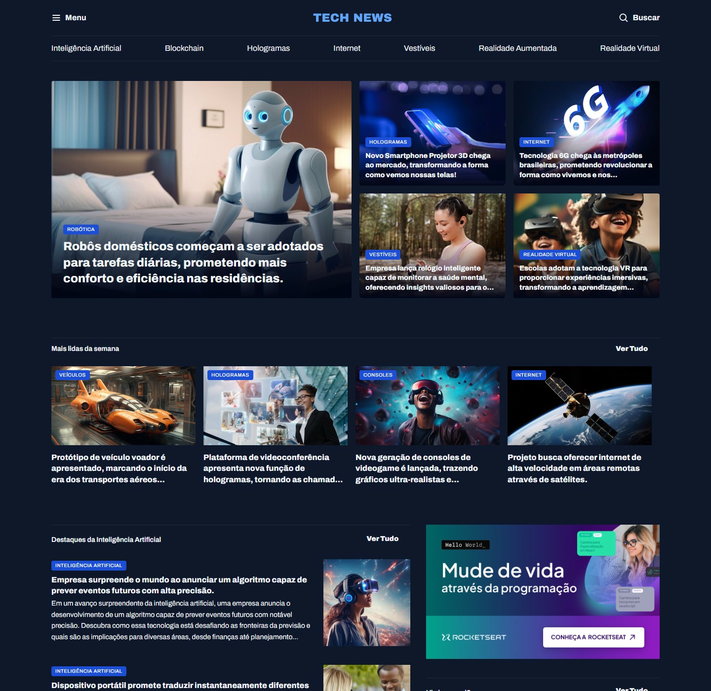

<p align="center">
  
</p>

<h1 align="center">Portal de Notícias</h1>

<p align="center">
  Projeto desenvolvido durante meus estudos de HTML e CSS na Rocketseat.
</p>

<p align="center">
  
  
</p>

<p align="center">
  <a href="#sobre">Sobre</a> &nbsp;·&nbsp;
  <a href="#aprendizados">Aprendizados</a> &nbsp;·&nbsp;
  <a href="#como-executar">Como executar</a>
</p>

<p align="center">
  
</p>

## Sobre

Construí o **Tech News** durante o curso Full Stack da Rocketseat, seguindo um layout no Figma para praticar HTML e CSS.

A página reúne notícias de tecnologia em diferentes formatos: um destaque principal, cards menores, as mais lidas da semana e uma coluna lateral com notícias complementares.

O foco foi aprender a organizar esses blocos com **CSS Grid** e reproduzir os espaçamentos, a tipografia e as cores do layout.

## Aprendizados

- Organizar a página com elementos semânticos, como `main`, `section`, `article` e `aside`.
- Usar Grid para distribuir cards e posicionar imagens ao lado dos textos.
- Criar variáveis para reutilizar cores e estilos de fonte.
- Aplicar gradientes sobre imagens para melhorar a leitura dos títulos.
- Reutilizar classes de espaçamento, tipografia e limite de linhas.

Durante o projeto, entendi melhor como as classes conectam o HTML ao CSS. Um espaço no lugar de um hífen em `grid-flow-col`, por exemplo, fez as imagens ficarem abaixo dos textos em vez de ao lado.

Outro desafio foi ajustar a largura dos cards para que os títulos tivessem as quebras de linha esperadas no Figma.

## Tecnologias

**HTML · CSS · Google Fonts**

Layout de referência no **Figma**.

## Como executar

Clone o repositório:

```bash
git clone https://github.com/rafadsdev/projeto-Portal-de-Noticias.git
```

Depois, abra o `index.html` no navegador ou utilize a extensão **Live Server** no VS Code.

Não é necessário instalar dependências.

## Organização

Os estilos estão separados em:

- `global.css`: cores, fontes e estrutura principal.
- `header.css`: navegação do cabeçalho.
- `sections.css`: estilos específicos das seções.
- `utility.css`: classes reutilizáveis.
- `index.css`: importação dos arquivos CSS.

---

Desenvolvido por [Rafael](https://github.com/rafadsdev) durante o curso Full Stack da [Rocketseat](https://www.rocketseat.com.br/).

Layout e materiais utilizados como parte das aulas.
